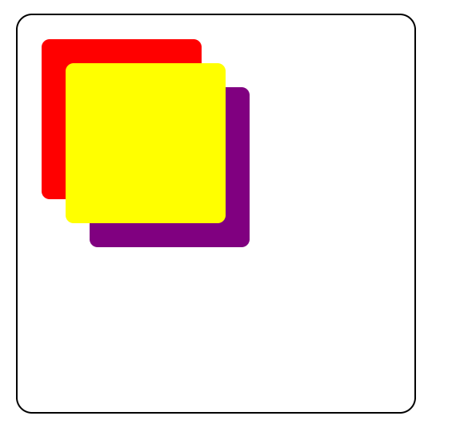
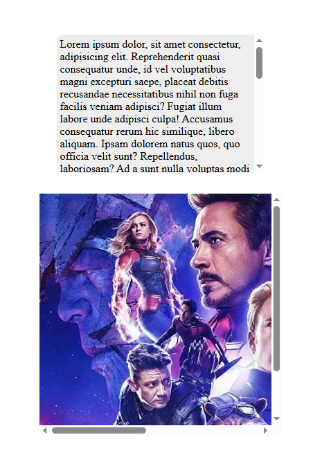
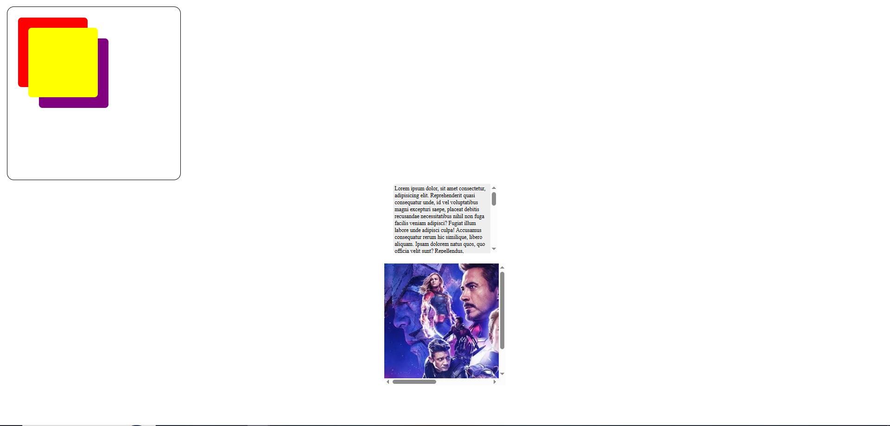

# 🎨 Z-Index & Overflow — CSS Project

A beginner-friendly web development project demonstrating CSS positioning, stacking order, and overflow behavior using colorful overlapping boxes, a scrollable text card, and an image container.

## 📌 About the Project

This project is created to practice fundamental CSS concepts, especially `z-index`, `position: relative`, `position: absolute`, and `overflow: auto`.

It demonstrates how elements overlap, how positioned elements are arranged in layers, and how scrolling works when content exceeds a container's dimensions.

## ✨ Features

* 🔴 **Overlapping Boxes:** Three colorful boxes with different `z-index` values.
* 📐 **CSS Positioning:** Demonstrates relative and absolute positioning.
* 📜 **Scrollable Text Card:** Handles long text using `overflow: auto`.
* 🖼️ **Image Container:** Demonstrates overflow behavior for image content.
* 🎨 **Modern Styling:** Rounded corners, background colors, and clean spacing.
* 💻 **Beginner-Friendly:** Simple HTML and CSS with no external libraries required.

## 🛠️ Technologies Used

* HTML5
* CSS3

## 📂 Project Structure

```text
z-index-overflow/
│
├── index.html
├── css/
│   └── style.css
└── README.md
```

## 🚀 How to Run the Project

**Step 1:** Clone the repository.

```bash
git clone https://github.com/YOUR_USERNAME/YOUR_REPOSITORY.git
```

**Step 2:** Open the project folder.

```bash
cd YOUR_REPOSITORY
```

**Step 3:** Open `index.html` in your browser.

You can also use the Live Server extension in Visual Studio Code.

## 📚 CSS Concepts Explained

### 1. Z-Index

The `z-index` property controls the stacking order of positioned elements within the same stacking context.

```css
.box1 {
    z-index: 300;
}

.box2 {
    z-index: 2000;
}

.box3 {
    z-index: 1;
}
```

The yellow box (`box2`) has the highest `z-index`, so it appears above the other boxes in their overlapping area, assuming they share the same stacking context.

### 2. Positioning

The container uses `position: relative`, while the boxes use `position: absolute`.

```css
.container {
    position: relative;
}

.box {
    position: absolute;
}
```

This allows the boxes to be positioned relative to their nearest positioned ancestor, which is `.container`.

### 3. Overflow on a Text Card

```css
.card {
    height: 200px;
    width: 300px;
    overflow: auto;
}
```

The `overflow: auto` property allows the text card to scroll when its content exceeds the available space.

### 4. Overflow on an Image Container

```css
.image {
    height: 350px;
    width: 350px;
    overflow: auto;
}
```

This demonstrates how a fixed-size container handles content that extends beyond its boundaries. Scrollbars appear when the content requires them.

## 🎯 Learning Outcomes

By completing this project, you can learn:

* How `z-index` controls overlapping elements.
* How `position: relative` and `position: absolute` work together.
* How `overflow: auto` manages overflowing content.
* How to create fixed-size containers.
* How to structure a basic HTML and CSS project.

## 🔮 Future Improvements

* Make the layout responsive for mobile devices.
* Add demonstrations of `overflow: hidden`, `scroll`, and `visible`.
* Add interactive controls to change `z-index` values.
* Include a screenshot of the project preview.
* Deploy the project using GitHub Pages.

## 🖥️ Output / Project Preview

### 📸 Screenshots

Here are some preview screenshots of the **Z-Index & Overflow CSS Project**.

| Z-Index Demo | Overflow Text Card |
|---|---|
|  |  |

### 🖼️ Image Overflow Demo

This preview demonstrates how images behave inside a fixed-size container using CSS overflow properties.



### 🎥 Video Demonstration

Watch the project demonstration to understand how `z-index`, CSS positioning, and overflow behavior work in practice.

[](https://www.youtube.com/watch?v=VIDEO_ID)

> **Note:** Replace the dummy image URLs with your actual project screenshots and replace `VIDEO_ID` with your YouTube video ID.

### 🔗 Live Project

- **GitHub Repository:** [View Source Code](https://github.com/SJaynesh)
- **Live Demo:** Add your deployed project URL here.


## 👨‍💻 Author

**Your Name**

* GitHub: [SJaynesh](https://github.com/SJaynesh)

---

If you find this project helpful, consider giving the repository a ⭐ star!

**License:** For educational and learning purposes.
